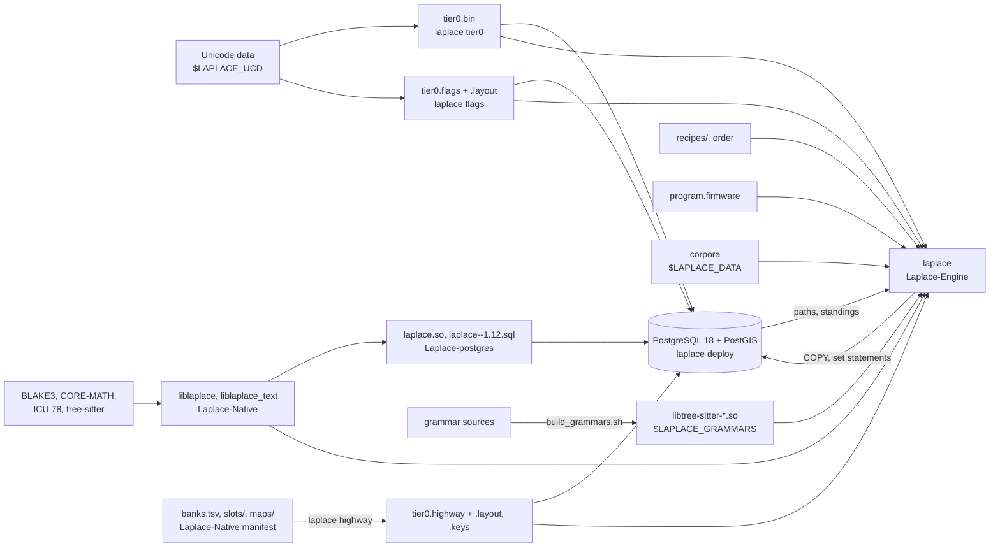

# Repositories

Five repositories implement Laplace: the monorepo SaltyPatron/Laplace is the first full implementation and holds the invention documents; Laplace-Native is the shared library, Laplace-postgres the PostgreSQL extension that links it, and Laplace-Engine the one program that links it and runs the database, the three the wiki calls Laplace itself; and Laplace-Prototype is the test bench the three are checked against.

## What each holds

| Repository | Version | Holds | Builds | Links |
| --- | --- | --- | --- | --- |
| Laplace-Native | 0.2.0 | `include/laplace/laplace.h`, the one public header; `src/`: `cpu.c`, `flags.c`, `utf8.c`, `identity.c`, `coord.c`, `compose.c`, `geometry.c`, `ids.c`, `follows.c`, `consensus.c`, `tier0.c`, `highway.c`, `trust.c`, `geom4d.c`, `pull.c`, `text.c`, `rowsig.c`, `isa/` kernels; `manifest/` (`banks.tsv`, the frozen slots `slots/`); `tests/`; `cmake/LaplacePaths.cmake`, `cmake/LaplaceFlags.cmake` | `liblaplace.a` and `liblaplace.so` (everything but text and model); `liblaplace_text` (needs ICU 78); `liblaplace_model` (needs MKL and OpenMP); `lp_crmath` (CORE-MATH `cr_sin`, `cr_cos`); BLAKE3 with its assembly | BLAKE3, libm, pthread |
| Laplace-postgres | the project version in `CMakeLists.txt`; the extension version is `default_version` in `laplace.control` | `src/*.c`; `manifest/function_bindings.tsv`; `sql/laplace.sql.in` with `sql/operations.sql`, `sql/api.sql` and `sql/path_set_match.sql`, from which the build generates the install script, the `laplace-storage:<hash>` stamp, and `laplace.reconcile.sql` for in-place routine updates; `laplace.control`; `bench/bench_queries.py` | `laplace.so` / `laplace.dll` into PostgreSQL's `pkglibdir`; the control, install, and reconcile SQL files into `sharedir/extension` | `LaplaceNative` package (`Laplace::laplace_static`, `Laplace::text`), PostgreSQL 18 headers, PostGIS geometry serialization |
| Laplace-Engine | 0.2.0 | `src/`: `main.c`, `engine.h`, `recipe.c`, `structure.c`, `structure.h`, `say.c`, `highway.c`, `table.c`, `file.c`, `ingest.c`, `db.c`, `read.c`, `pull.c`, `forward.c`, `fills.c`, `forget.c`, `deploy.c`, `tier0.c`, `flags.c`, `firmware.c`, `program.c`, `bench.c`, `model.c`; `recipes/`; `firmware/program.firmware`; `tools/build_grammars.sh` | `laplace`, one executable | `laplace_text`, `laplace_static`, `lp_crmath`, BLAKE3, the tree-sitter runtime, libpq, OpenMP, zlib, dl; `laplace_model` when MKL is present |
| SaltyPatron/Laplace, the monorepo | engine 0.1.0 | `docs/` (the invention documents and specs), `engine/` (core, synthesis, dynamics, manifests), `extension/laplace_substrate` and `laplace_geom`, `app/` (twelve .NET projects), `web/`, `recipes/`, `seeds/`, `db/migrations`, `scripts/` | `liblaplace_core`, `liblaplace_dynamics`, `liblaplace_synthesis`, `laplace_substrate.so`, `laplace_geom.so`, the application, the web, the perfcaches; see [Monorepo](Monorepo.md) | PostgreSQL 18 and PostGIS at `/opt/laplace/pgsql-18`, tree-sitter, MKL, TBB, .NET 10 |
| Laplace-Prototype | | `tier0/gen_tier0.py`, `ducet_order.py`, `nfd17.py`, `fingerprint.txt`; `dag/ingest.c`; `db/schema.sql`, `indexes.sql`, `load.sh`, `ext/`; `tests/verify.py`, `queries.py`, `gap_query.py`, `breaktest.c`; `chess/`, `semantics/`, `models/`, `code/`, `recipes/` | the golden values the native tests reproduce | ICU 78, BLAKE3, PostgreSQL 18 at port 5439 |

Laplace-Operations holds what sets up the machine, locks verified component revisions (`components.lock.tsv`), deploys and fills the databases, and syncs canonical agent instructions (`laplace.env`, `laplace.ps1`, `laplace-ops`, `setup.sh`, `build.sh`, `deploy.sh`, `ingest.sh`, `agents/` and the workflows). [Laplace-MCP](Laplace-MCP.md) exposes the native substrate over HTTP and MCP (`lpm` and `Laplace.Modular.Web`), `Laplace-UCI` provides the UCI relay and Lichess connector, and Laplace-Wiki holds this documentation.

`Laplace-postgres`, `Laplace-Engine`, and `Laplace-MCP` consume `Laplace-Native` as an installed CMake/native package (`find_package(LaplaceNative CONFIG REQUIRED)`) and keep no copy of anything in it: every layer shares one native implementation of every semantic operation.

`SaltyPatron/Laplace` (the monorepo) came first and built the complete end-to-end product surfaces (OpenAI-compatible `/v1/*` API, MCP, Web UI and Glome, Chess Lab, Foundry / Mold-a-Model synthesis and export, Code player, Knowledge Arena, and billing/royalties) alongside the original invention documents. The modular repositories (`Laplace-Native`, `Laplace-postgres`, `Laplace-Engine`, `Laplace-MCP`, `Laplace-UCI`) isolate each reusable substrate layer into its own package, and the monorepo is actively converging onto those packages (`one-substrate`) while retiring its pre-modular substrate copies (`extension/laplace_substrate`, `laplace_geom`, and duplicate `engine/core` primitives; see [Monorepo: How it differs](Monorepo.md#how-it-differs-from-the-split-repositories)). `Laplace-Refactor` was an intermediate cleanroom workstream whose layer-boundary concepts live in [Engineering](../Engineering/README.md) and whose code repository is frozen.

## The artifact graph

An arrow is a build-time or run-time dependency: the artifact at its tail must exist, at the version the head was built or configured for, before the head can run. Tier 0 and the flags are generated from the Unicode data by the engine and read by both the engine and the extension; the two must map the same file, which [`laplace status`](CLI.md#laplace-status) checks by fingerprint.

## What the prototype is for

The prototype established the golden values: the tier-0 IDs, coordinates, and Hilbert values in `tier0/tier0.bin` and its fingerprint; the decomposition of plain text; the schema; the checks in `tests/verify.py`. Laplace-Native's tests reproduce those values bit for bit, on both compilers. The prototype's schema differs from the built one in two tables, `source` and `entity_stats`, which the built schema does not have; see [Schema](Schema.md).
